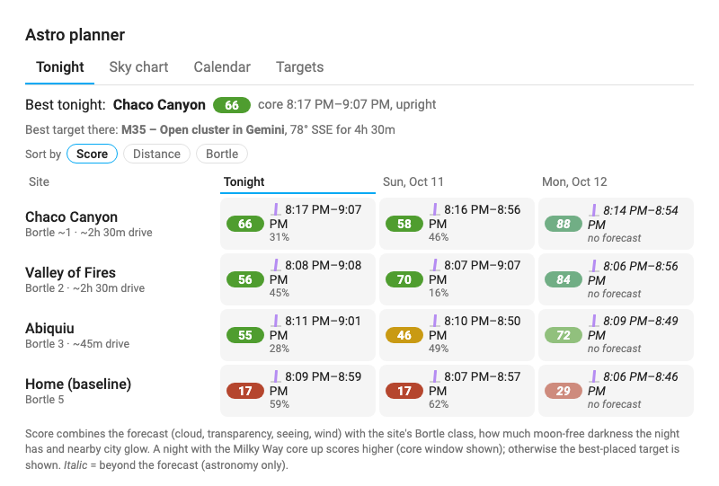
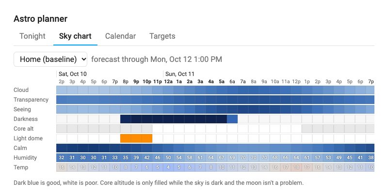
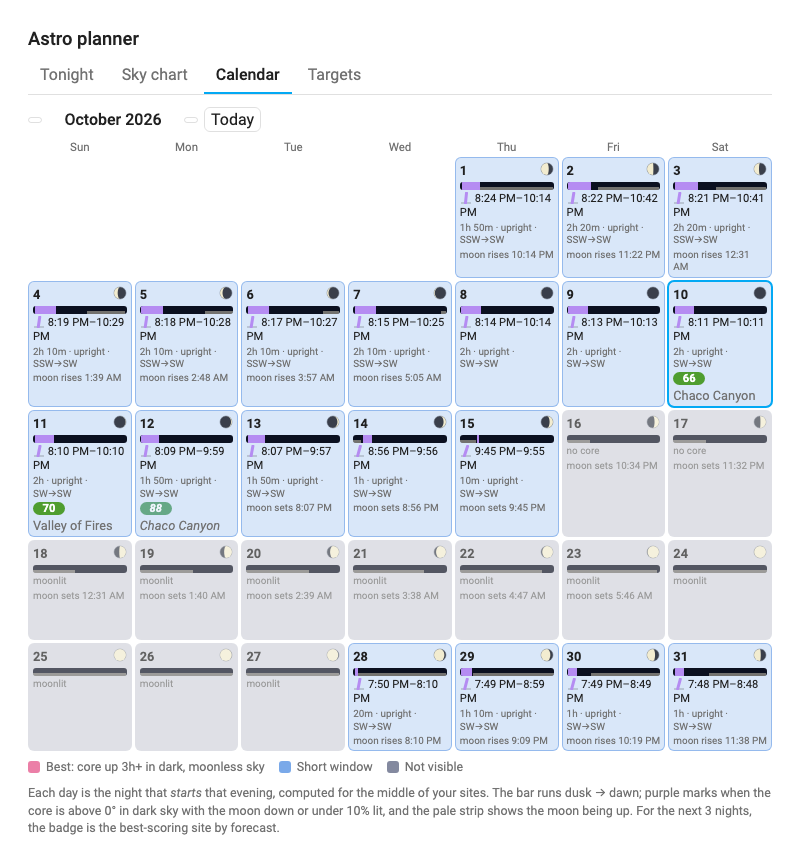

# Milky Way Planner Card

A Home Assistant Lovelace card for planning **Milky Way core** photography from several candidate dark-sky sites. It builds on
the [AstroWeather](https://github.com/mawinkler/astroweather) integration for forecasts and adds the astronomy planning around it:

- **Tonight / ranking**: your sites ranked for tonight and the next few nights, combining the forecast during the window when the
  galactic core is up and dark with moon, light-dome direction and site darkness.
- **Sky chart**: a [Clear Dark Sky](https://www.cleardarksky.com/)-style hourly chart per site: cloud, transparency, seeing, darkness,
  core altitude, light-dome interference, wind, humidity and temperature.
- **Calendar**: a month grid in the spirit of [Capture the Atlas](https://capturetheatlas.com)'s Milky Way charts, for picking the best
  nights to go (it isn't tied to one site). Each day shows moon phase, the dusk→dawn bar with the core-up-and-dark window highlighted,
  window times, and whether the Milky Way will stand *upright*, sit *angled* or lie as a low *arch*. Days can be coloured pink / blue /
  dark for best / short window / not visible, and the next few nights show the best-scoring site by forecast.

Everything is configurable from the card's visual editor.

| Tonight | Sky chart |
|---|---|
|  |  |



*Screenshots use simulated forecast data from the development harness.*

## Requirements

- Home Assistant 2024.4 or newer
- [HACS](https://hacs.xyz)
- The **[AstroWeather](https://github.com/mawinkler/astroweather)** integration (a required dependency, installed through HACS).
  AstroWeather Card is *not* required.

## Setting up your sites

The card ranks one **AstroWeather instance per location**, so first add an instance for each place you'd consider shooting from.
Include your home as a baseline.

1. Install AstroWeather via HACS and restart Home Assistant.
2. **Settings → Devices & services → Add integration → AstroWeather**, once per site. For each:
   - give it a recognizable name (it becomes `weather.astroweather_<name>`),
   - enter the site's latitude, longitude and elevation, and your time zone,
   - leave the update interval alone for now: as of AstroWeather v0.80.0 the interval you enter isn't saved (it stays at the 5-minute default), so
     keep the number of instances reasonable and be kind to the upstream weather services.
3. Pick sites so the **sky behind your target isn't toward a city**: e.g. if the core sits in the south, a site north of a large
   city will shoot through its glow. The card's light-dome logic flags this per night.

The card reads each instance's coordinates from AstroWeather's latitude/longitude sensors, so you only enter them once.

## Installation

1. HACS → ⋮ → **Custom repositories** → add this repository, category **Dashboard** (Lovelace).
2. Install **Milky Way Planner Card** and reload the browser.
3. Add the card to a dashboard (**Add card → Milky Way Planner**) and use the editor:
   - **Sites**: add each AstroWeather entity ("Add all AstroWeather entities" is a shortcut). Optionally set a display name, the site's
     [Bortle class](https://en.wikipedia.org/wiki/Bortle_scale) and the drive time.
   - **Drive time** is looked up automatically from your Home Assistant location to each site (see [Privacy](#privacy-and-third-party-services)).
     Enter a value for a site to override it.
   - **Light domes**: press **Find nearby cities** to look up populated places around your Home Assistant location and your sites
     (via [Wikidata](https://www.wikidata.org), falling back to [OpenStreetMap](https://www.openstreetmap.org)). The result is stored in the card config; edit or add places freely.

Manual YAML:

```yaml
type: custom:milky-way-planner-card
title: Milky Way planner
default_tab: ranking
nights: 3
min_gc_altitude: 10          # degrees; core must be at least this high
max_moon_illumination: 10    # %; a lit moon only counts as "dark" below this (or when set)
sites:
  - entity: weather.astroweather_home
    name: Home (baseline)
    bortle: 5
  - entity: weather.astroweather_remote_site
    bortle: 2
    drive_minutes: 120
light_domes:
  - { name: Example City, latitude: 35.08, longitude: -106.65, population: 560000 }
```

### Options

| Option | Default | Description |
|---|---|---|
| `sites` | required | List of `{entity, name?, bortle?, drive_minutes?, latitude?, longitude?}` |
| `light_domes` | `[]` | List of `{name, latitude, longitude, population}` |
| `title` | none | Card title |
| `tabs` | all | Tabs to show, in order: any of `ranking`, `chart`, `calendar`. With one tab the tab bar is hidden |
| `default_tab` | `ranking` | `ranking`, `chart` or `calendar` (falls back to the first enabled tab) |
| `default_sort` | `score` | Initial sort on the Tonight view: `score`, `distance` (drive time, shortest first) or `bortle` (darkest first). Also switchable with the chips above the list; ties fall back to score |
| `nights` | `3` | Nights scored in the ranking and calendar overlay (1–7) |
| `min_gc_altitude` | `10` | Minimum core altitude (°) to count as usable in the ranking, chart and scores |
| `max_moon_illumination` | `10` | Moon is ignored below the horizon or when ≤ this % lit |
| `weights` | cloud 3, transparency 2, seeing 0.5, calm 1 | Relative weights of the weather score |
| `dome_radius_km` | `250` | Search radius for **Find nearby cities** |
| `auto_drive_time` | `true` | Look up driving time from your Home Assistant location to each site that has no `drive_minutes` |
| `calendar_highlight` | `true` | Colour calendar days: pink = best, blue = short window, dark = core not visible |
| `calendar_best_minutes` | `180` | Core window (minutes, in dark moonless sky) a day needs to count as "best" (pink) |
| `calendar_min_altitude` | `0` | Altitude (°) above which the core counts in the calendar. Capture the Atlas counts from the horizon, so the calendar does too; `min_gc_altitude` (default 10°) applies to the ranking and chart |
| `dome_sigma` | `25` | (YAML) Angular spread (°) of a city's glow |
| `dome_warning_threshold` | `0.15` | (YAML) Penalty above which a dome warning shows |

## How it works

- **Accuracy**: the computed core windows for 37°N agree with Capture the Atlas's 2026 calendar to within a few minutes, and so does the
  arch/angled/upright progression. The calendar's colours follow the same rule they use: pink when the moonless core window is at least
  3 hours, blue when it's shorter, dark when there is none. That matches the colour of 50 of the 52 weekly rows in their table
  (see `test/capturetheatlas.test.ts`); the other two are within minutes of the cutoff.
- **Sun, moon and galactic center positions** are computed in the browser with
  [astronomy-engine](https://github.com/cosinekitty/astronomy). A night is "dark" when the sun is below −18° and the moon is down or
  nearly new; the core window is the dark time with the core above your minimum altitude.
- **Milky Way orientation** is the tilt of the galactic plane at the core relative to the horizon: under 30° *arch*, 30–60° *angled*,
  over 60° *upright*.
- **Light domes** use a Walker's-law-style glow (`population × distance^-2.5`), weighted by how close the core's azimuth is to each
  city's bearing and by how low the core is. The penalty reduces a site's score and raises a warning naming the city.
- **Score** (0–100) is the mean weather quality over the core window (cloud, transparency, seeing, wind, with penalties for rain or
  fog) × window length × (1 − dome penalty) × a small Bortle factor. Nights beyond AstroWeather's forecast horizon show an
  astronomy-only score in *italics*.
- Forecasts come from AstroWeather's `weather/subscribe_forecast` hourly feed, so they update live.

## Privacy and third-party services

Everything is computed in your browser, with two optional lookups that contact public services directly from the browser viewing the card:

- **Drive times** → [OSRM demo server](https://router.project-osrm.org) (`router.project-osrm.org`). It receives your Home Assistant location and each
  site's location, **rounded to about 1 km**, and returns a driving time. Results are cached in the browser's local storage (90 days), so each
  route is requested once. If the server is unreachable, a straight-line estimate is used. Turn it off with `auto_drive_time: false`, or give a site `drive_minutes`.
- **Nearby cities** → only when you press **Find nearby cities** in the editor. The card asks the [Wikidata Query Service](https://query.wikidata.org)
  first and falls back to community-run [Overpass](https://overpass-api.de) (OpenStreetMap) servers if it can't answer. Whichever answers receives a
  bounding box around your Home Assistant location and your sites. The Overpass servers are often busy or reject requests, so the card tries each in turn
  and reports every failure; if all fail, retry later or add cities by hand.

## Development

```bash
npm install
npm test            # vitest: astronomy, scoring, city lookup
npm run typecheck
npm run build       # → dist/milky-way-planner-card.js
npm run serve       # http://localhost:8123/dev/ — harness with a mocked hass
```

### Releasing

Versions follow [semver](https://semver.org). `npm version patch|minor|major` bumps `package.json` and tags; `git push --follow-tags`
triggers the Release workflow, which tests, builds and publishes a GitHub release with `milky-way-planner-card.js` attached. HACS
tracks releases, so Home Assistant then offers the update.

## Credits and data

- [AstroWeather](https://github.com/mawinkler/astroweather) by mawinkler: forecast data.
- [astronomy-engine](https://github.com/cosinekitty/astronomy) by Don Cross: ephemerides.
- City data from [Wikidata](https://www.wikidata.org) (CC0), or © [OpenStreetMap](https://www.openstreetmap.org/copyright) contributors (ODbL) via the Overpass API, fetched on demand.
- Inspired by [Clear Dark Sky](https://www.cleardarksky.com/) and [Capture the Atlas](https://capturetheatlas.com).

## License

MIT
