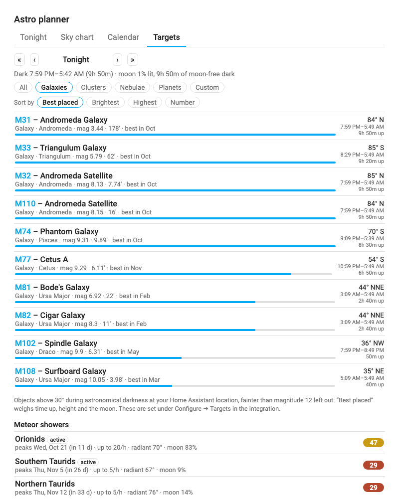

# Astro Planner Card

A Home Assistant Lovelace card for planning **astrophotography** from several candidate dark-sky sites: which site has the best
sky tonight, when the Milky Way is up, and which Messier objects and planets are worth shooting. It builds on the
[AstroWeather](https://github.com/mawinkler/astroweather) integration for forecasts and adds the astronomy planning around it
(it was the *Milky Way Planner Card* before it grew beyond the Milky Way):

- **Tonight / ranking**: your sites ranked for tonight and the next few nights by sky quality and forecast (Bortle class, moon-free
  darkness, city glow, cloud, transparency, seeing). A night with the Milky Way core up scores higher; otherwise the cell shows the
  best-placed target at that site.
- **Sky chart**: a [Clear Dark Sky](https://www.cleardarksky.com/)-style hourly chart per site: cloud, transparency, seeing, darkness,
  core altitude, light-dome interference, wind, humidity and temperature.
- **Calendar**: a month grid in the spirit of [Capture the Atlas](https://capturetheatlas.com)'s Milky Way charts, for picking the best
  nights to go (it isn't tied to one site). Each day shows moon phase, the dusk→dawn bar with the core-up-and-dark window highlighted,
  window times, and whether the Milky Way will stand *upright*, sit *angled* or lie as a low *arch*. Days can be coloured pink / blue /
  dark for best / short window / not visible, and the next few nights show the best-scoring site by forecast.
- **Targets**: the Messier objects (named, e.g. *M1 – Crab Nebula*), planets and any custom targets that are up after dark at your Home
  Assistant location on a chosen night, with how high, which direction, when and for how long. Filter by galaxies / clusters / nebulae /
  planets, sort by best placed / brightest / highest / number, step through nights or weeks to see what's coming into season, and (if
  you set a field of view in the integration) hide what's too big for your gear. Upcoming meteor showers are listed underneath.

| Tonight | Sky chart |
|---|---|
|  |  |

| Targets | Calendar |
|---|---|
|  |  |

*Screenshots use simulated forecast data from the development harness.*

## Requirements

- Home Assistant 2024.4 or newer
- [HACS](https://hacs.xyz)
- The **[Astro Planner integration](https://github.com/fwump38/astro-planner)**, which does all the astronomy, scoring, city lookups and drive times.
  **The card is only a display for it and shows a message until the integration is set up.**
- The **[AstroWeather](https://github.com/mawinkler/astroweather)** integration, one instance per site (AstroWeather Card is *not* required).

## Setting up your sites

The planner ranks one **AstroWeather instance per location**, so first add an instance for each place you'd consider shooting from.
Include your home as a baseline.

1. Install AstroWeather via HACS and restart Home Assistant.
2. **Settings → Devices & services → Add integration → AstroWeather**, once per site. For each:
   - give it a recognizable name (it becomes `weather.astroweather_<name>`),
   - enter the site's latitude, longitude and elevation, and your time zone,
   - leave the update interval alone for now: as of AstroWeather v0.80.0 the interval you enter isn't saved (it stays at the 5-minute default), so
     keep the number of instances reasonable and be kind to the upstream weather services.
3. Pick sites so the **sky behind your target isn't toward a city**: e.g. if the core sits in the south, a site north of a large
   city will shoot through its glow. The light-dome logic flags this per night.
4. Install and add the **Astro Planner integration** (see its README). It picks up every AstroWeather site automatically; Bortle
   class, drive time, light domes, score weights and thresholds are all set there.

## Installation

[](https://my.home-assistant.io/redirect/hacs_repository/?owner=fwump38&repository=astro-planner-card&category=plugin)

1. HACS → ⋮ → **Custom repositories** → add this repository, category **Dashboard** (Lovelace).
2. Install **Astro Planner Card** and reload the browser.
3. Add the card to a dashboard (**Add card → Astro Planner**). There is nothing to configure unless you want to change what it shows.

Manual YAML (everything is optional):

```yaml
type: custom:astro-planner-card
title: Astro planner
default_tab: ranking
```

### Options

| Option | Default | Description |
|---|---|---|
| `title` | none | Card title |
| `tabs` | all | Tabs to show, in order: any of `ranking`, `chart`, `calendar`, `targets`. With one tab the tab bar is hidden |
| `default_tab` | `ranking` | `ranking`, `chart`, `calendar` or `targets` (falls back to the first enabled tab) |
| `default_sort` | `score` | Initial sort on the Tonight view: `score`, `distance` (drive time, shortest first) or `bortle` (darkest first). Also switchable with the chips above the list; ties fall back to score |
| `forecast_days` | `3` | Nights shown on the Tonight view, counting tonight as 1. Capped at the number of nights the integration scores |
| `sites` | all of the integration's sites | List of AstroWeather entity ids to show (e.g. for a dashboard about one region) |
| `calendar_highlight` | `true` | Colour calendar days: pink = best, blue = short window, dark = core not visible |

Everything else lives in the integration: the sites, target altitude / brightness / field of view limits, custom targets, Bortle classes (estimated from nearby towns unless you set them), drive times, light
domes, number of nights, minimum core altitude, moon limit, score weights and the calendar's thresholds. Older card options for those
(`light_domes`, `nights`, `min_gc_altitude`, `weights`, `use_integration`, …) and per-site settings are ignored.

## How it works

The card asks the integration for its sites and their scored nights, for the calendar's nights, and for the hourly sky behind the chart,
and draws the answers. Nothing is calculated in your browser. The only data the card reads itself is AstroWeather's hourly forecast
(`weather/subscribe_forecast`), which it shows in the chart so it updates live.

- A night is "dark" when the sun is below −18° and the moon is down or nearly new; the core window is the dark time with the core above
  your minimum altitude. Pink calendar nights have a window of at least 3 hours, blue a shorter one, dark none.
- **Milky Way orientation** is the tilt of the galactic plane at the core relative to the horizon: under 30° *arch*, 30–60° *angled*,
  over 60° *upright*.
- **Light domes** use a Walker's-law-style glow (`population × distance^-2.5`), weighted by how close the core's azimuth is to each
  city's bearing and by how low the core is. The penalty reduces a site's score and raises a warning naming the city.
- **Score** (0–100) is the mean weather quality (cloud, transparency, seeing, wind, with penalties for rain or fog) times the sky
  quality: the Bortle class, how much moon-free darkness the night has and the city glow across the sky. The sky alone is worth up to 70;
  the Milky Way core being up adds the rest. Nights beyond AstroWeather's forecast horizon show an astronomy-only score in *italics*.
- **Targets** are listed for your Home Assistant location, using the integration's minimum altitude. “Best placed” weighs time above
  that altitude, how high the object gets and how much the moon interferes.
- The integration's accuracy against Capture the Atlas's 2026 calendar (core windows within a few minutes at 37°N, and 50 of 52 weekly
  colours) is tested in the integration's repository.

## Privacy and third-party services

The card contacts nothing but your Home Assistant. The integration's lookups (drive times via the public OSRM server, nearby cities via
GeoNames or Wikidata) are described in the [integration's README](https://github.com/fwump38/astro-planner#privacy).

## Development

```bash
npm install
npm test            # vitest: config and the integration's responses
npm run typecheck
npm run build       # → dist/astro-planner-card.js
npm run serve       # http://localhost:8123/dev/ — harness with a mocked hass and integration (see below)
```

The harness needs canned integration responses, which the integration's repo generates (`dev/mock.json` is git-ignored):

```bash
cd ../astro-planner && PYTHONPATH=. .venv/bin/python scripts/export_card_mock.py ../astro-planner-card/dev/mock.json
```

### Releasing

Versions follow [semver](https://semver.org). `npm version patch|minor|major` bumps `package.json` and tags; `git push --follow-tags`
triggers the Release workflow, which tests, builds and publishes a GitHub release with `astro-planner-card.js` attached. HACS
tracks releases, so Home Assistant then offers the update.

## Credits and data

- [AstroWeather](https://github.com/mawinkler/astroweather) by mawinkler: forecast data.
- Inspired by [Clear Dark Sky](https://www.cleardarksky.com/) and [Capture the Atlas](https://capturetheatlas.com).

## License

MIT
